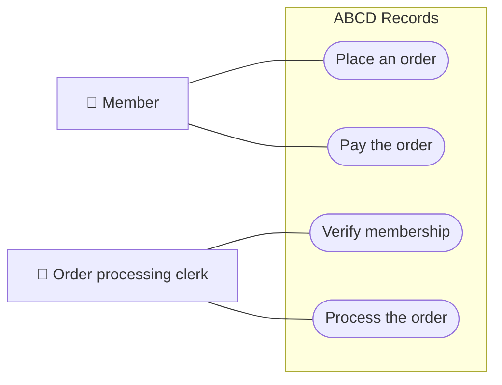
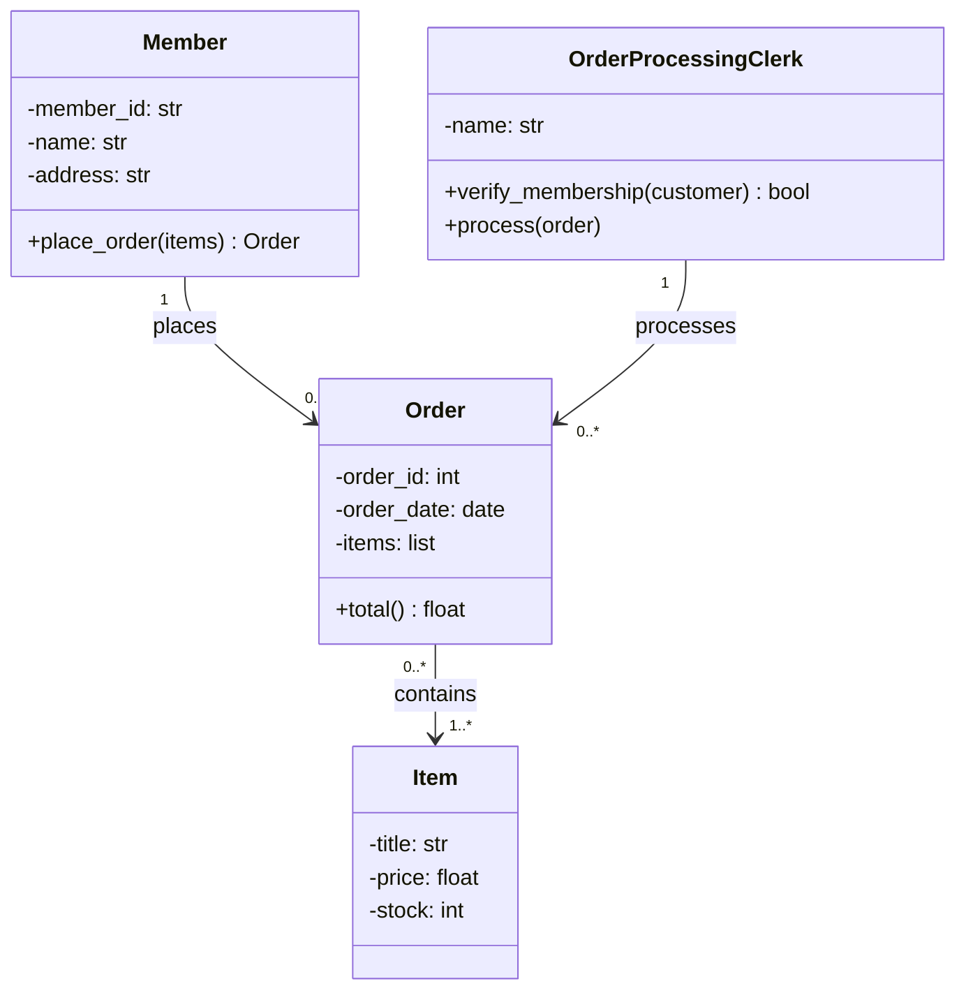
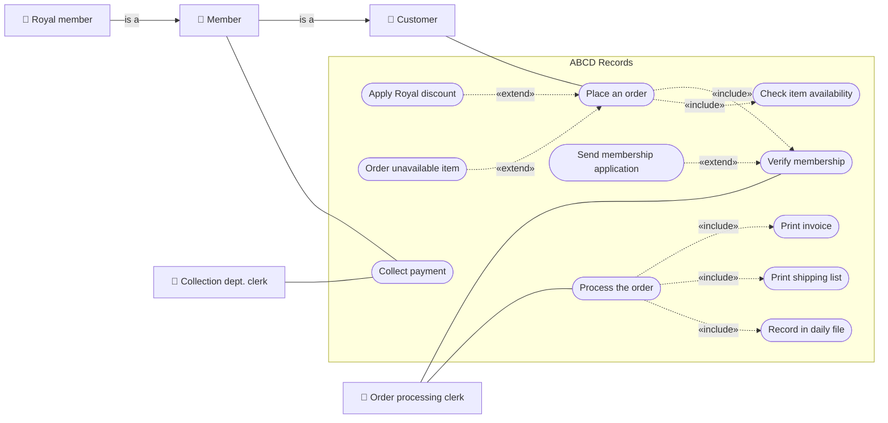
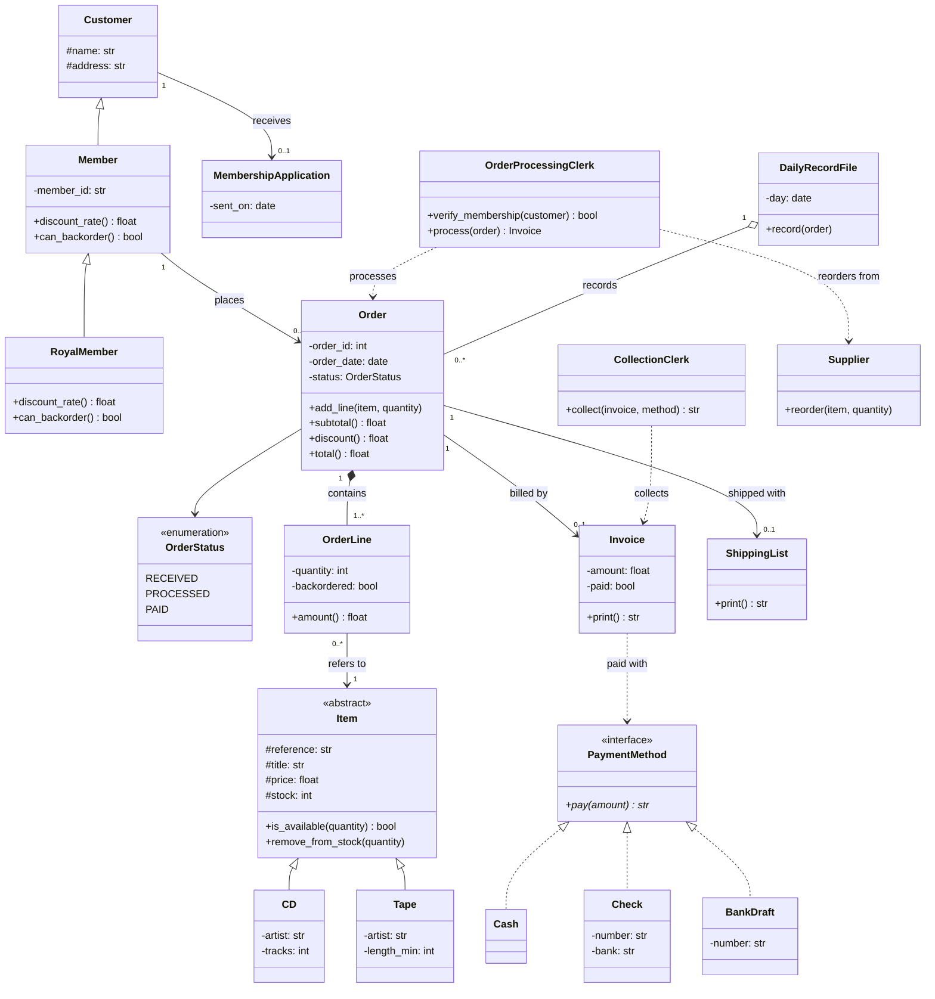
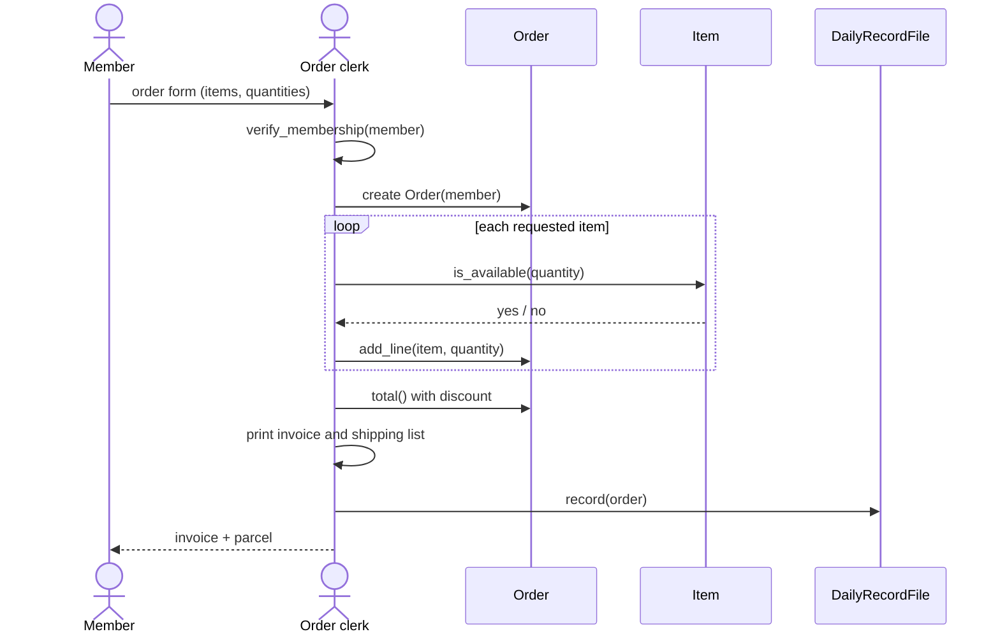
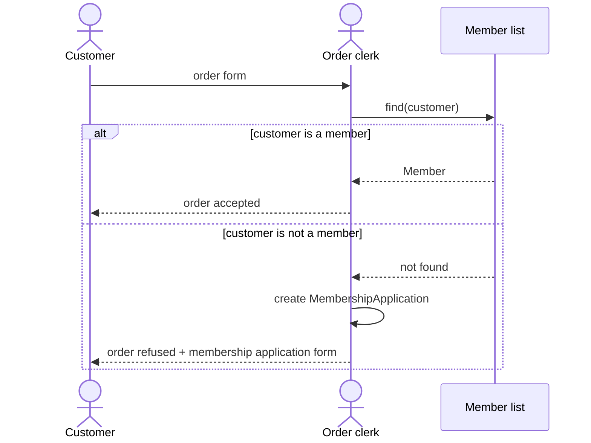
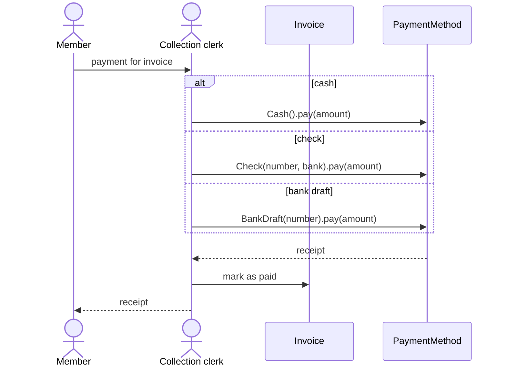
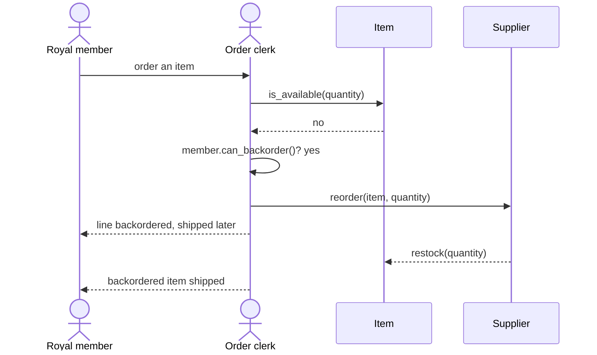

# Exercise 2 - ABCD Records (CD and tape mail-order company)

Exercise: https://gist.github.com/bdallard/2d2407c4de4c182afca6d3ec7235e9eb (slide 68) ·
Code: [`abcd_records.py`](abcd_records.py)

> Mermaid has no real use case diagram, so I draw them as flowcharts: actors are on the sides,
> use cases are the rounded boxes inside the **ABCD Records** frame (the system boundary), and
> dotted arrows are the `«include»` / `«extend»` relations.

## Level 1

### Task 1.1 - Simple use case diagram

### Task 1.2 - Basic class diagram

## Level 2

### Task 2.1 - Complete use case diagram

- **`«include»`** = always part of the base use case: placing an order always verifies the membership
  and the availability of the items; processing an order always prints the invoice and the shipping list.
- **`«extend»`** = only in some cases: the discount and the order of unavailable items only happen
  for Royal members; the membership application is only sent when the customer is not a member.

### Task 2.2 - Complete class diagram

Design choices:

- `Customer` is the parent of everybody who writes to the company. A `Member` has a member id;
  `RoyalMember` overrides two methods: `discount_rate()` (10%) and `can_backorder()` (True).
  This avoids `if member.type == "royal"` tests everywhere in the code.
- `Item` is abstract, `CD` and `Tape` add their own attributes.
- An `Order` is **composed** of `OrderLine`s (a line does not exist without its order); a line
  points to an `Item` and knows if it is backordered.
- The three payment types share the `PaymentMethod` interface (Strategy).

#### Scenario that checks the diagram

A Royal member orders one CD in stock and one tape out of stock, and pays by check:

1. the clerk verifies the membership (OK) and the availability of each item;
2. the tape is not available, but a Royal member can backorder: the line is marked `backordered` and
   the tape is reordered from the supplier;
3. the 10% Royal discount is applied; the invoice shows the total, the shipping list contains only the CD;
4. the order is recorded in the daily file, and the collection clerk receives the check.

This scenario is the `__main__` of [`abcd_records.py`](abcd_records.py) and is also a test.

## Level 3 - Sequence diagrams

### 1. Complete order processing

### 2. Membership verification

### 3. Payment processing

### 4. Reordering an item for a Royal member

