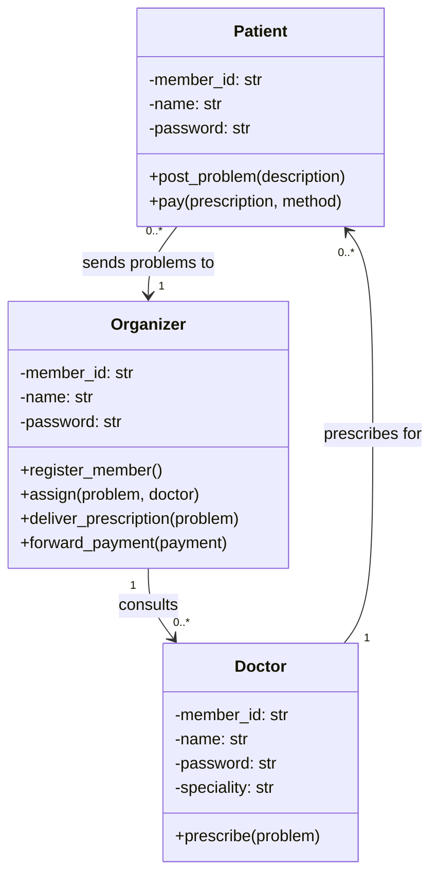
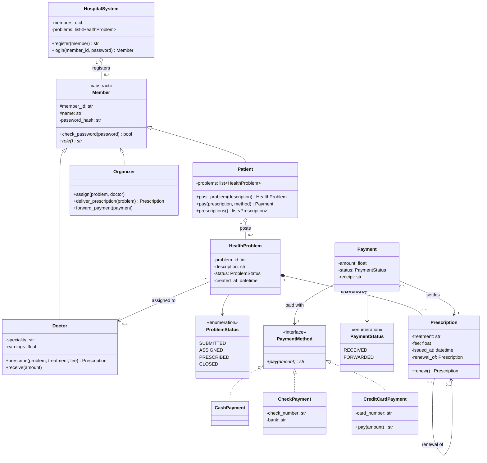
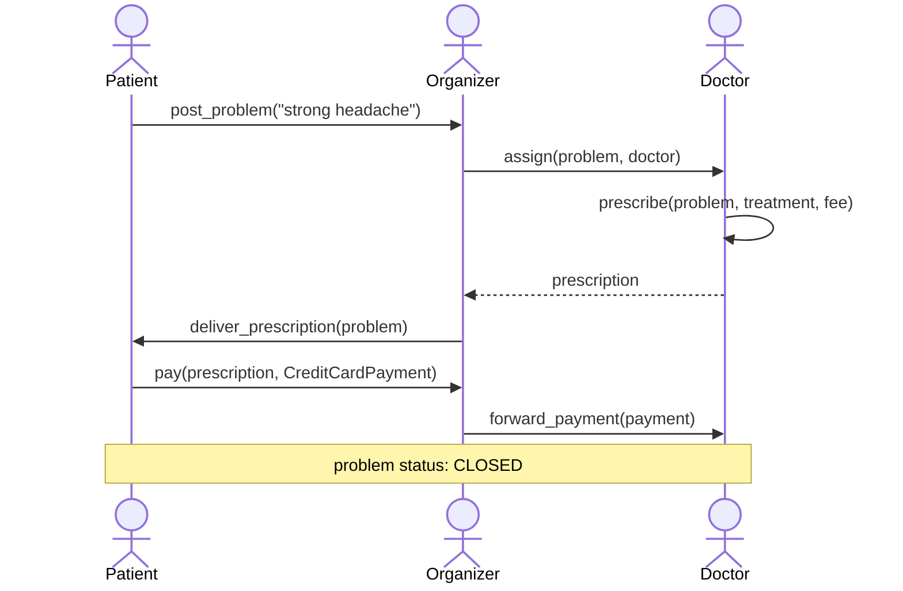
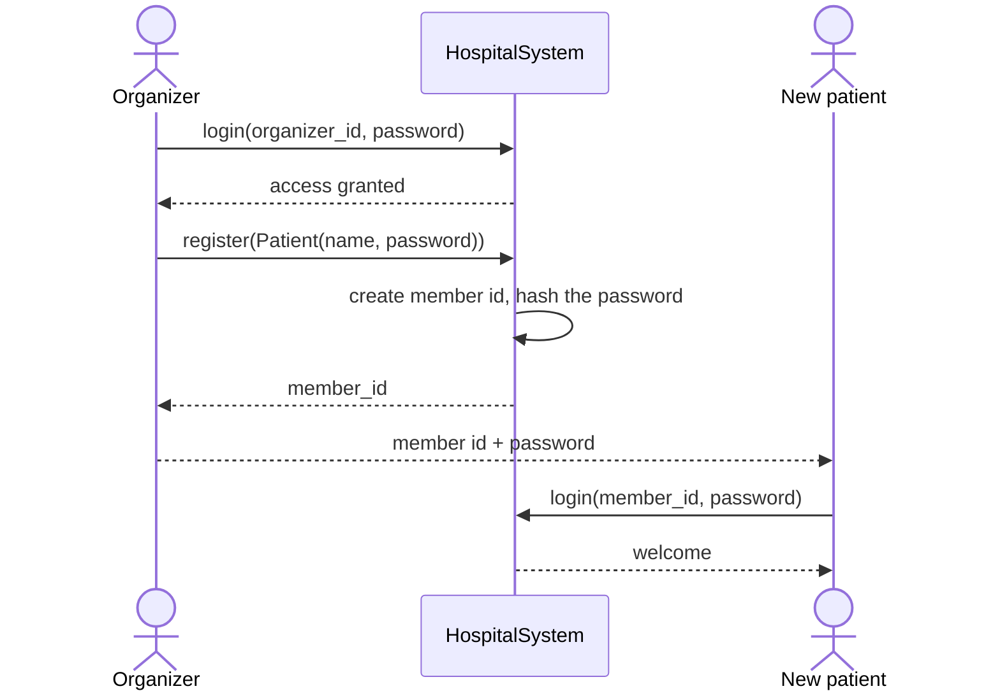
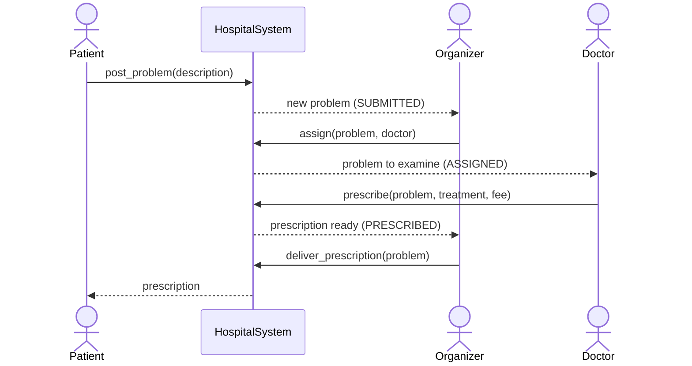
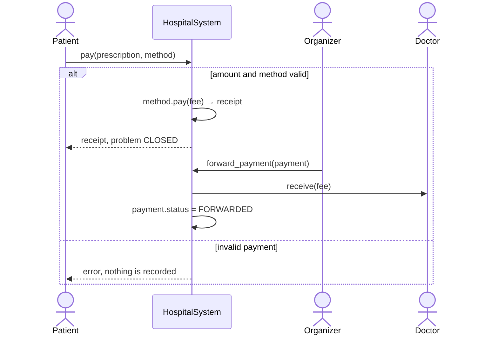

# Exercise 1 - Online hospital management system

Exercise: https://gist.github.com/bdallard/2d2407c4de4c182afca6d3ec7235e9eb (slide 68) ·
Code: [`hospital.py`](hospital.py)

All diagrams are written in [Mermaid](https://mermaid.js.org/), so GitHub draws them directly.

## Task 1 - Basic class diagram

The three actors of the statement and what each of them does.

## Task 2 - Detailed class diagram

Design choices:

- **`Member`** is an abstract parent class: the three roles share an id, a name and a password,
  so these attributes and `check_password()` are written once. The password is stored as a hash.
- **`HealthProblem`** is the central object: it links a patient, the doctor in charge and the
  prescription, and its `ProblemStatus` follows the life cycle `SUBMITTED → ASSIGNED → PRESCRIBED → CLOSED`.
- **Composition** `HealthProblem *-- Prescription`: a prescription has no meaning without the problem
  it answers, it is created by the problem's doctor and dies with it.
- **Aggregation** `Patient o-- HealthProblem`: the patient keeps the history of his problems.
- **`PaymentMethod`** is an interface with three implementations (cash, check, credit card). A
  `Payment` *uses* a method instead of being subclassed: this is the **Strategy** pattern.
- **`PaymentStatus`** (`RECEIVED → FORWARDED`) prevents a payment from being forwarded twice.

### Sequence diagram - from a problem to a paid prescription

## Task 3 - System sequence diagrams

The system is a black box: these diagrams only show the messages between the actors and the system.

### 1. Registration of a new patient

### 2. Consultation

### 3. Payment

## Questions

**1. How can a patient consult several doctors?**
Each `HealthProblem` has its own doctor, so a patient with several problems already sees several
doctors. If one problem needs several doctors (a second opinion, a specialist), the link
`HealthProblem → Doctor` can become `0..*`, or better an association class `Consultation`
(problem, doctor, date, notes) between the two.

**2. How can prescriptions be reused?**
A renewal is a new `Prescription` that points to the previous one (`renewal_of`). The history is
kept, each renewal has its own date and fee, and the original prescription is never modified.

**3. Which design pattern fits the payment?**
**Strategy**: the three payment methods share the `PaymentMethod` interface and the rest of the
system calls `method.pay(amount)` without knowing which one it is. Adding a new method (bank
transfer, mobile payment) does not change any existing class. A **Factory** can be added to create
the right method from the patient's choice.

**4. How to guarantee the integrity of payments?**
- the amount must be equal to the prescription fee, and a prescription can only be paid once;
- a payment is forwarded only if its status is `RECEIVED`, then it becomes `FORWARDED`: it can never
  be forwarded twice;
- in a real system, "record the payment" and "credit the doctor" are done in one **database
  transaction**: both succeed or both are cancelled;
- each payment keeps its receipt and date (audit trail), and card numbers are never stored in full.
