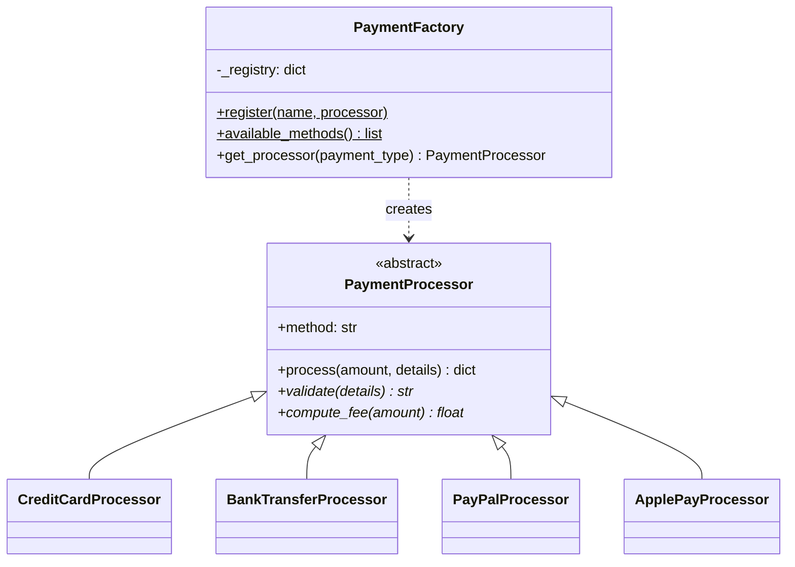
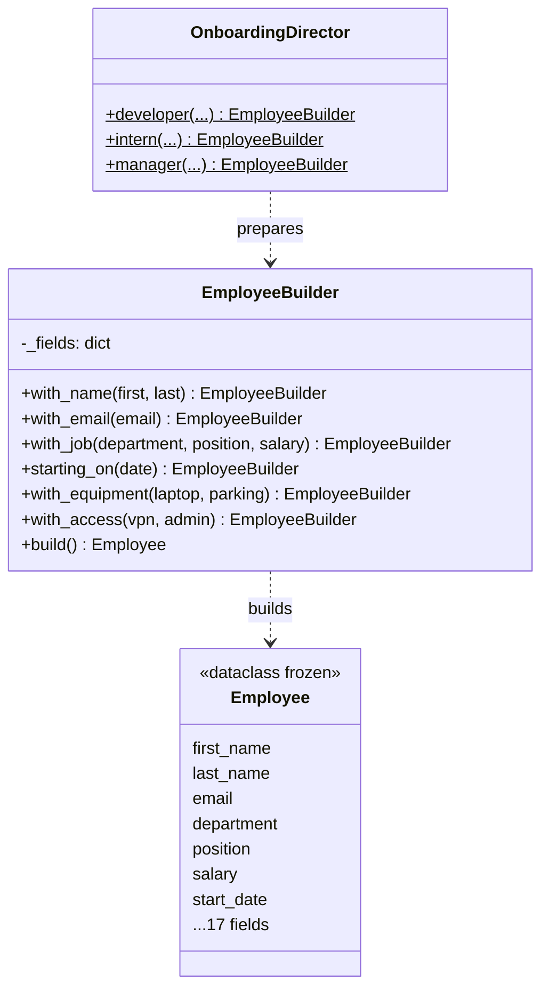
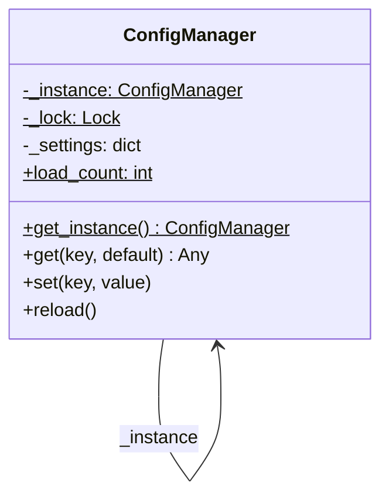
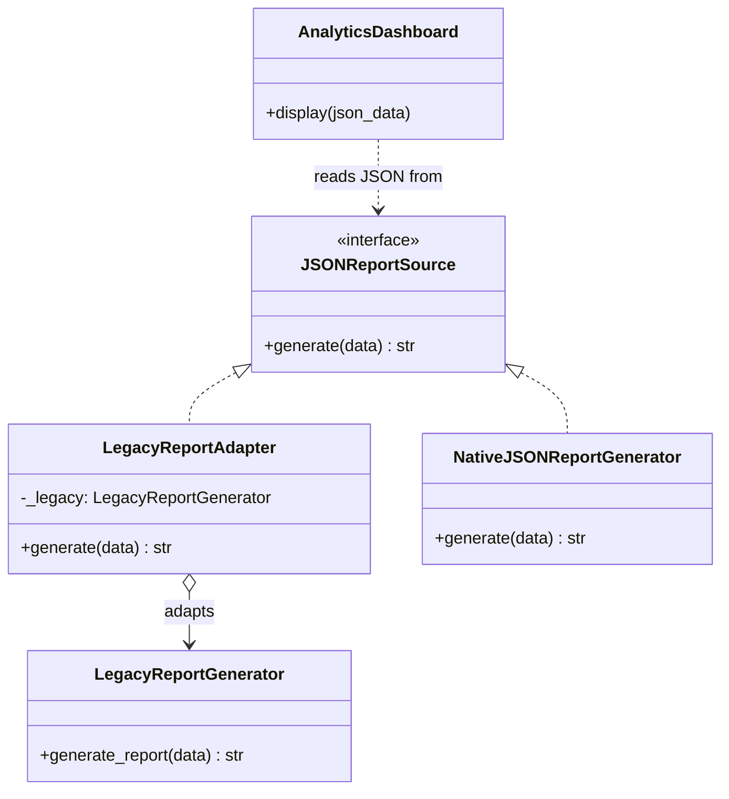
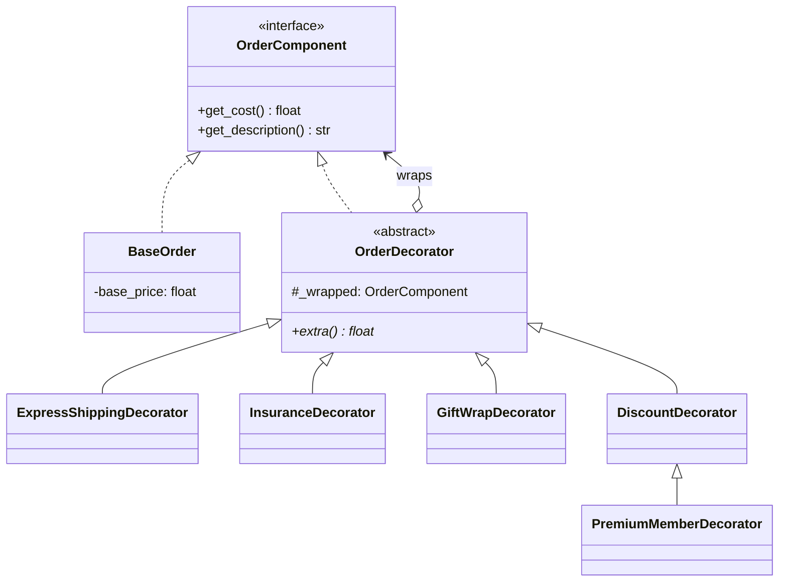
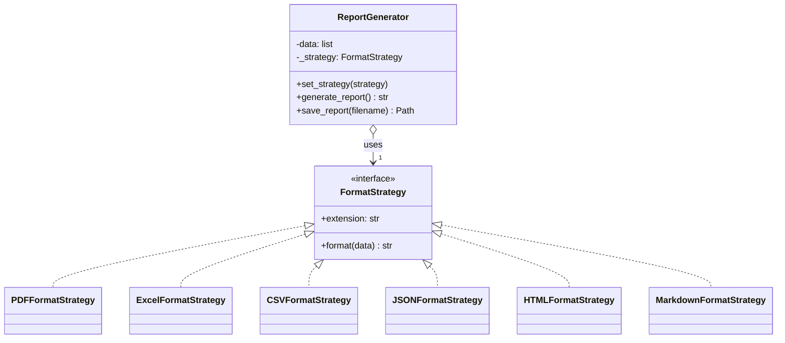
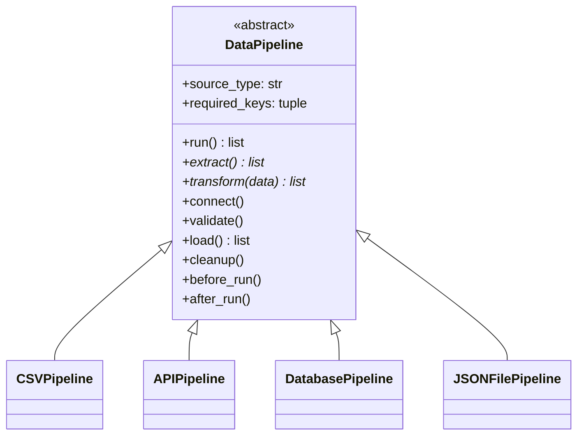

# 05 - Design patterns

Exercises: [creational patterns](https://courses.dallard.tech/sys_design/creational_pattern/),
structural patterns and behavioral patterns (slides 70-87).

Each exercise starts from "spaghetti" code. In every file, the docstring at the top lists the
problems of the original code (and answers the questions of the statement), then comes the
refactored code, and the `__main__` block shows the expected usage.

| Family | Pattern | Exercise | File |
|---|---|---|---|
| Creational | Factory | Payment processing | [`creational/factory_payment.py`](creational/factory_payment.py) |
| Creational | Builder | HR employee onboarding | [`creational/builder_employee.py`](creational/builder_employee.py) |
| Creational | Singleton | Configuration manager | [`creational/singleton_config.py`](creational/singleton_config.py) |
| Structural | Adapter | Legacy XML reports → JSON dashboard | [`structural/adapter_report.py`](structural/adapter_report.py) |
| Structural | Decorator | Order pricing options | [`structural/decorator_order.py`](structural/decorator_order.py) |
| Behavioral | Strategy | Multi-format reports | [`behavioral/strategy_report.py`](behavioral/strategy_report.py) |
| Behavioral | Template Method | ETL pipelines | [`behavioral/template_etl.py`](behavioral/template_etl.py) |

```bash
cd 05-design-patterns
python creational/factory_payment.py      # same for every file
cd ..
python -m pytest                          # 46 tests for this folder
```

## The common idea

All seven refactorings follow the same principles:

- **Single Responsibility**: one class = one reason to change (one payment method, one format, one option).
- **Open/Closed**: a new case (Apple Pay, HTML, a new pipeline) is a *new class*; the working code is not modified.
- **Depend on an interface**, not on concrete classes: the client code only knows `PaymentProcessor`,
  `JSONReportSource`, `FormatStrategy`...
- **Composition over inheritance** when behaviors must be combined (Adapter, Decorator, Strategy).

Each file ends with an extension test that checks the last point: a new case is added without
touching the existing classes.

---

## Factory - payment processing

**Problem**: one function with an `if/elif` per payment method. **Solution**: one class per method
with the same interface, and a factory that maps a name to a class through a registry. Classes
register themselves with the `@PaymentFactory.register("name")` decorator, so the factory itself
never changes: Apple Pay was added this way.



`process()` is written once in the parent (check the amount → `validate()` → `compute_fee()` →
result): the subclasses only give their rules.

## Builder - employee onboarding

**Problem**: a function with 17 positional parameters and unreadable booleans. **Solution**: named,
chainable methods (each returns `self`), all the checks in `build()`, and an `OnboardingDirector`
that knows the standard recipes (developer, intern, manager). The director returns a *builder*,
not an employee, so a preset can still be customised before `build()`.



Business rules checked in `build()`: required fields, valid email, salary ≥ 0, known contract
type, and an intern can never get admin rights.

## Singleton - configuration manager

**Problem**: every module reads `config.json` again and keeps its own copy. **Solution**: only one
`ConfigManager` exists. `__new__` (the method that creates the object, called before `__init__`)
returns the existing instance after the first call, so the file is read once and every module
shares the same settings. A lock with a double check makes it safe with threads.



`get("database.port")` reads nested values with a dotted key. The tests show that the file is
read once, even with 20 threads asking for the manager at the same time.

## Adapter - legacy XML reports

**Problem**: the legacy generator (that we cannot modify) returns XML, the dashboard reads JSON,
and the conversion was copied in every function. **Solution**: the business code depends on the
`JSONReportSource` interface. `LegacyReportAdapter` implements it, wraps the legacy object and
really parses the XML (with `xml.etree`), giving numbers and booleans their type back.



`NativeJSONReportGenerator` shows the benefit: when the old system disappears, the new generator
plugs into the same interface and the business code does not change.

## Decorator - order pricing

**Problem**: five boolean flags in one method, and an order of calculation hidden in the code.
**Solution**: each option is a decorator that wraps an order and has the same interface
(`get_cost()`, `get_description()`). Options are stacked like layers, and the stacking order *is*
the order of the calculation.



Each option only writes `extra()` (the amount it adds or removes); the parent class adds it to the
cost and to the receipt. A premium member is simply a discount with a fixed 10 % rate.

## Strategy - multi-format reports

**Problem**: two `if/elif` chains (generate and save), formats impossible to test alone or to
change at runtime. **Solution**: one strategy class per format; `ReportGenerator` holds the data
and delegates to its current strategy, which can be replaced with `set_strategy()`.



HTML and Markdown were added at the end without changing any existing class. Saved reports go
into `behavioral/output/` (ignored by Git).

## Template Method - ETL pipelines

**Problem**: three pipelines with the same `run()` and copy-pasted connect / validate / load /
cleanup code. **Solution**: `DataPipeline.run()` defines the algorithm once (the template method).
Subclasses only write `extract()` and `transform()`, and can override the hooks `before_run()` /
`after_run()`.



Every step goes through `_step()`, which logs it with its duration: logging (question 3 of the
statement) was added in one place and all the pipelines got it. `JSONFilePipeline` is the
extension test, and it uses the `after_run()` hook.
